# Haushaltsbuch – Anleitung

Diese Anleitung erklärt, wie du das Haushaltsbuch im Alltag benutzt: Ausgaben erfassen, Kontoauszüge einlesen,
Kassenbons fotografieren, Auswertungen ansehen, Termine mit Budgets planen und sehen, wie sich die Kontostände entwickeln.

> Alle Bilder stammen aus einem Beispiel-Haushalt („Familie Muster“) mit ausgedachten Zahlen.

**Inhalt**

1. [Anmelden und zurechtfinden](#1-anmelden-und-zurechtfinden)
2. [Die Übersicht](#2-die-übersicht)
3. [Eine Buchung erfassen](#3-eine-buchung-erfassen)
4. [Buchungen suchen und bearbeiten](#4-buchungen-suchen-und-bearbeiten)
5. [Kontoauszug importieren (CSV)](#5-kontoauszug-importieren-csv)
6. [Einkäufe, Kassenbons und Einkaufsliste](#6-einkäufe-kassenbons-und-einkaufsliste)
7. [Vorrat und Rezepte](#7-vorrat-und-rezepte)
8. [Fixkosten und Daueraufträge](#8-fixkosten-und-daueraufträge)
9. [Kategorien und Regeln](#9-kategorien-und-regeln)
10. [Auswertungen](#10-auswertungen)
11. [Prognose](#11-prognose)
12. [Kalender](#12-kalender)
13. [Kredite](#13-kredite)
14. [Claude auf dem Smartphone](#14-claude-auf-dem-smartphone)
15. [Für Administratoren: Konten, Familie, Einstellungen](#15-für-administratoren-konten-familie-einstellungen)
16. [Häufige Fragen](#16-häufige-fragen)

---

## 1. Anmelden und zurechtfinden

Öffne die Adresse des Haushaltsbuchs im Browser und melde dich mit deiner E-Mail-Adresse und deinem Passwort an.
Dein Zugang wird von der Person angelegt, die das Haushaltsbuch verwaltet (Administrator).

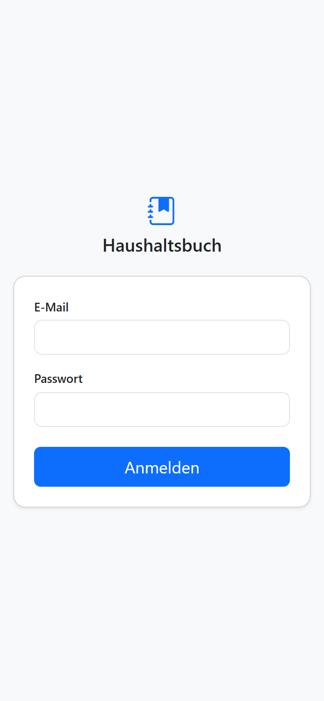

Nach fünf falschen Passwörtern ist der Zugang für 15 Minuten gesperrt. Dein Passwort änderst du selbst unter
**Einstellungen → Mein Passwort ändern**.

Unter **Einstellungen → Meine Vorzugskonten** legst du fest, welches Konto bei *Einkauf erfassen* (bezahlt von),
*Kontoauszug importieren*, *Neue Buchung* und als Ziel einer *Umbuchung* vorausgewählt ist. Jede Person hat eigene
Vorzugskonten; ohne Vorgabe gilt beim Einkauf das zuletzt benutzte Konto, sonst das erste der Liste.

### Am Computer

Links steht das Menü mit allen Bereichen. Unter **Verwaltung** findest du Konten, Kategorien, Regeln, Familie und
Einstellungen. Ganz unten wechselst du zwischen hellem und dunklem Design (Symbol ◐) und meldest dich ab.

### Auf dem Handy

Unten gibt es eine Leiste mit **Übersicht**, **Buchungen**, **Einkäufe** und **Mehr**. Über den runden
**+‑Knopf** in der Mitte erfasst du schnell etwas Neues: eine Ausgabe, eine Einnahme, eine Umbuchung, einen Kassenbon,
einen Einkauf, eine PDF-Rechnung, einen Kontoauszug oder Fixkosten. Unter **Mehr** stehen alle übrigen Bereiche.

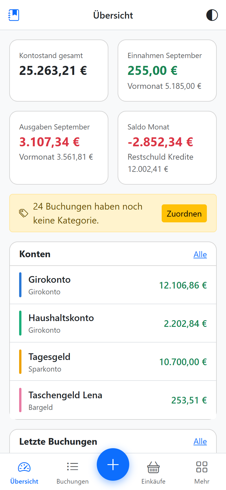 &nbsp;
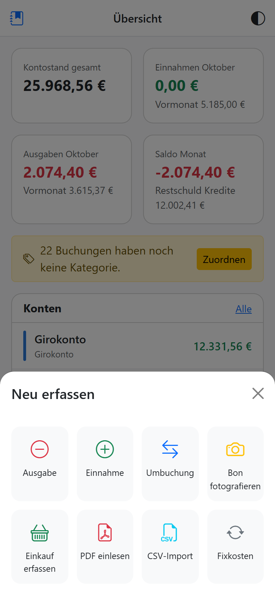 &nbsp;
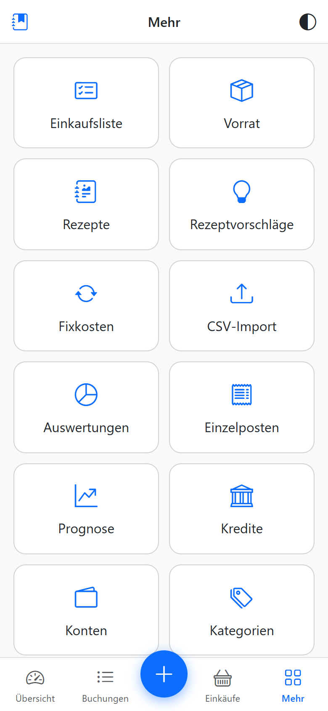

> **Tipp – als App installieren:** Im Handy-Browser über das Menü „Zum Startbildschirm hinzufügen“ (Android: ⋮,
> iPhone: Teilen-Symbol) wählen. Das Haushaltsbuch startet dann wie eine App ohne Adressleiste.

### Wer darf was?

| Rolle | Darf |
|---|---|
| **Administrator** | alles: alle Konten sehen und bebuchen, Konten, Kategorien, Personen und Einstellungen verwalten |
| **Mitglied** | die Konten sehen bzw. bebuchen, die für diese Person freigegeben sind; eigene Regeln anlegen |
| **Kind** | wie Mitglied, aber ohne Regeln zu ändern |

Siehst du ein Konto nicht, das du brauchst, bitte einen Administrator, es für dich freizugeben.

---

## 2. Die Übersicht

Die Startseite zeigt auf einen Blick:

- **Kontostand gesamt**, **Einnahmen** und **Ausgaben** des laufenden Monats (mit Vergleich zum Vormonat) sowie den
  **Saldo** des Monats und die Restschuld von Krediten.
- Einen gelben Hinweis, wenn Buchungen noch **keine Kategorie** haben. Mit **Zuordnen** kommst du direkt zu diesen Buchungen.
- Deine **Konten** mit aktuellem Stand, die **letzten Buchungen**, die **Ausgaben dieses Monats** nach Kategorie,
  eine **Prognose** für die nächsten drei Monate und die **nächsten Fixkosten**.

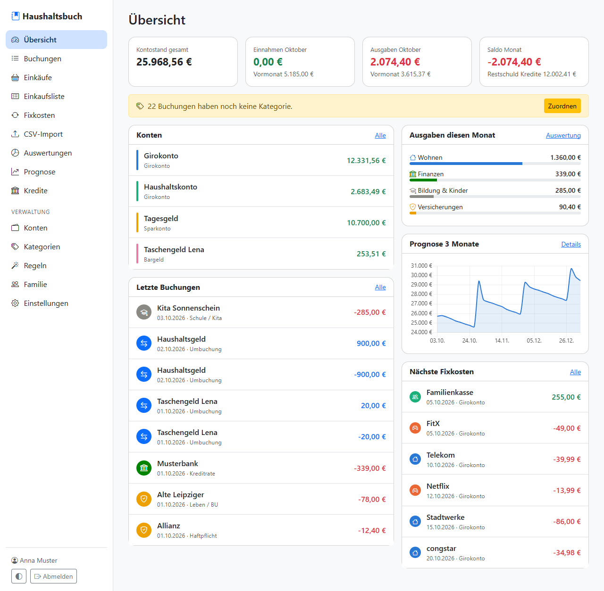

Fast alles ist anklickbar: Ein Konto führt zu seinen Buchungen, „Auswertung“ zu den Auswertungen, „Details“ zur Prognose.

---

## 3. Eine Buchung erfassen

Über **+ → Ausgabe** (Handy) oder **Buchungen → + Buchung** (Computer):

1. Oben die Art wählen: **Ausgabe**, **Einnahme** oder **Umbuchung**.
2. **Betrag** eingeben. Das Vorzeichen setzt das Haushaltsbuch selbst, Ausgaben also ohne Minus eintippen.
3. **Konto**, **Kategorie**, **Datum** und **Empfänger / Geschäft** angeben. Sobald du einen Empfänger eintippst,
   wird eine passende Kategorie vorgeschlagen (z. B. „REWE“ → Lebensmittel).
4. **Speichern**. Mit **Speichern & weitere** bleibt das Formular offen, praktisch zum Nachtragen mehrerer Belege.

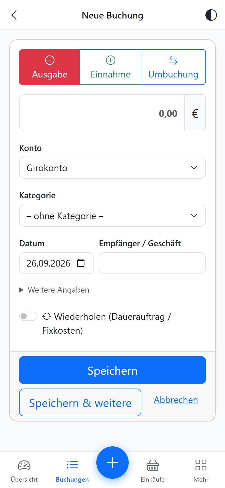 &nbsp;
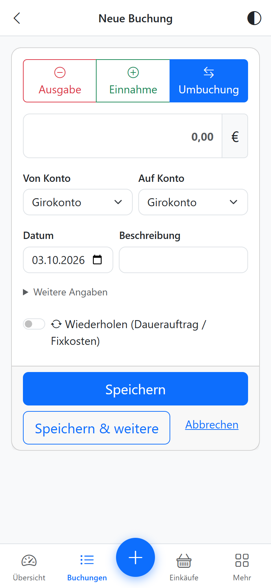

- **Umbuchung** = Geld wandert zwischen zwei eigenen Konten, z. B. vom Girokonto aufs Tagesgeld. Sie zählt weder als
  Einnahme noch als Ausgabe. Machst du aus einer vorhandenen Buchung nachträglich eine Umbuchung und steht die
  Gegenbuchung schon auf dem anderen Konto (z. B. aus dessen Kontoauszug), wird diese übernommen statt doppelt angelegt.
- **Weitere Angaben** öffnet Felder für Verwendungszweck und Notiz.
- **Wiederholen (Dauerauftrag / Fixkosten)**: Ist der Schalter an, wird aus der Buchung gleich eine wiederkehrende Buchung
  (siehe [Fixkosten](#8-fixkosten-und-daueraufträge)).

---

## 4. Buchungen suchen und bearbeiten

Unter **Buchungen** stehen alle Umsätze, nach Tagen gruppiert. Über den Filter oben grenzt du die Liste ein:

- **Konten** antippen, um sie ein- oder auszublenden (Mehrfachauswahl),
- **Suche** nach Empfänger oder Verwendungszweck,
- **Kategorie** (auch „⚠ Ohne Kategorie“), **Art** (Ausgaben, Einnahmen, Umbuchungen, Fixkosten), **Person**,
- **Zeitraum**: dieser/letzter Monat, 3/6/12 Monate, dieses/letztes Jahr oder frei wählbar.

Die Anzahl und die Summen der Einnahmen und Ausgaben unter dem Filter beziehen sich immer auf die gefilterte Liste.

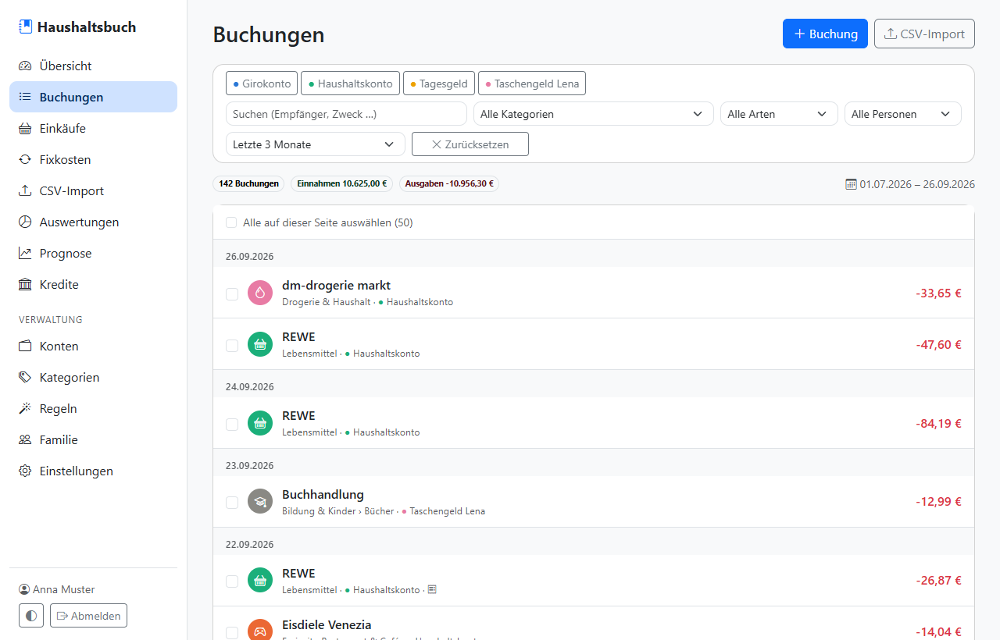

Eine Buchung antippen, um sie zu **bearbeiten** oder zu **löschen**. Buchungen mit dem Symbol 🧾 sind mit einem
Einkauf verknüpft.

**Mehrere Buchungen auf einmal:** Häkchen links setzen (oder „Alle auf dieser Seite auswählen“). Unten erscheint dann eine
Leiste mit den Aktionen **Kategorie zuordnen**, **Anderem Konto zuweisen**, **Als Fixkosten übernehmen** und **Löschen**.

---

## 5. Kontoauszug importieren (CSV)

Statt alles einzutippen, kannst du die Umsätze aus dem Online-Banking übernehmen.

1. Im Online-Banking die Umsätze als **CSV-Datei** herunterladen (bei der Sparkasse das „CSV-CAMT-Format“).
2. Im Haushaltsbuch **CSV-Import** öffnen, das **Konto** wählen und die Datei hineinziehen oder auswählen.
   Das Format wird meist automatisch erkannt. Mitgeliefert sind Sparkasse, ING, DKB, Volksbank/Raiffeisen,
   comdirect, Commerzbank, Postbank und N26.
3. **Weiter zur Vorschau**.

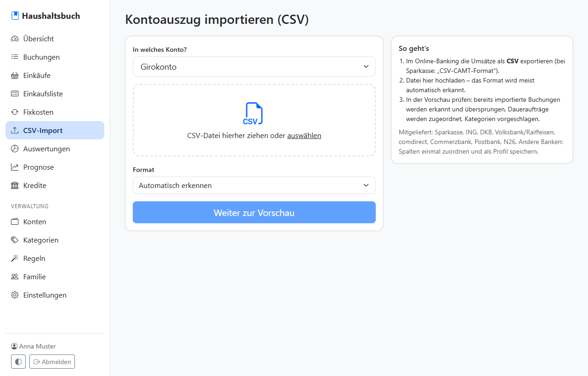

In der **Vorschau** prüfst du jede Zeile, bevor etwas gespeichert wird:

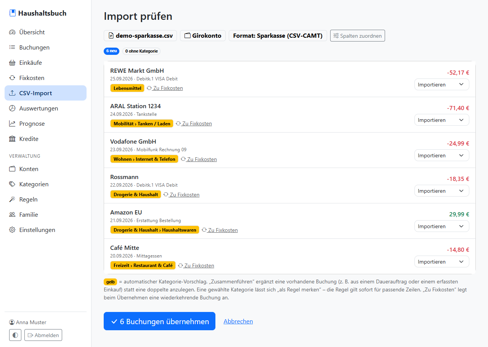

- **Gelb** markierte Kategorien sind Vorschläge. Du kannst sie ändern und mit **Als Regel merken** festlegen, dass
  dieser Empfänger künftig immer so eingeordnet wird.
- Rechts wählst du je Zeile: **Importieren**, **Überspringen** oder **Zusammenführen**. „Zusammenführen“ erscheint, wenn es
  schon eine passende Buchung gibt (z. B. aus einem Dauerauftrag oder einem erfassten Einkauf). Dann wird diese ergänzt statt doppelt angelegt.
- **Als Umbuchung** wird vorgeschlagen, wenn Geld zwischen zwei eigenen Konten wandert. Erkannt wird das an der
  **IBAN des Gegenkontos** (deshalb bei allen Konten die IBAN eintragen) oder – wenn der Kontoauszug keine IBAN
  enthält – an einer genau gegenläufigen Buchung auf einem anderen Konto innerhalb von drei Tagen.
  Steht die Gegenbuchung schon auf dem anderen Konto (z. B. aus dessen Kontoauszug), wird sie verknüpft; sonst wird
  sie dort angelegt und beim späteren Import des anderen Kontos automatisch zusammengeführt.
- Bereits früher importierte Zeilen werden erkannt und übersprungen. Du kannst also überlappende Zeiträume
  bedenkenlos erneut importieren.
- **Zu Fixkosten** legt aus der Zeile gleich eine wiederkehrende Buchung an, z. B. für einen neuen Handyvertrag.

Zum Schluss **… Buchungen übernehmen**.

> Kennt das Haushaltsbuch das Format deiner Bank nicht, ordnest du in der Vorschau über **Spalten zuordnen** einmal zu,
> welche Spalte Datum, Betrag, Empfänger usw. enthält, und speicherst das als Profil.

---

## 6. Einkäufe, Kassenbons und Einkaufsliste

Unter **Einkäufe** hältst du fest, **was** du gekauft hast, nicht nur wie viel. So siehst du später z. B., wie viel
auf Obst oder Süßes entfällt und wie sich der Preis der Milch entwickelt.

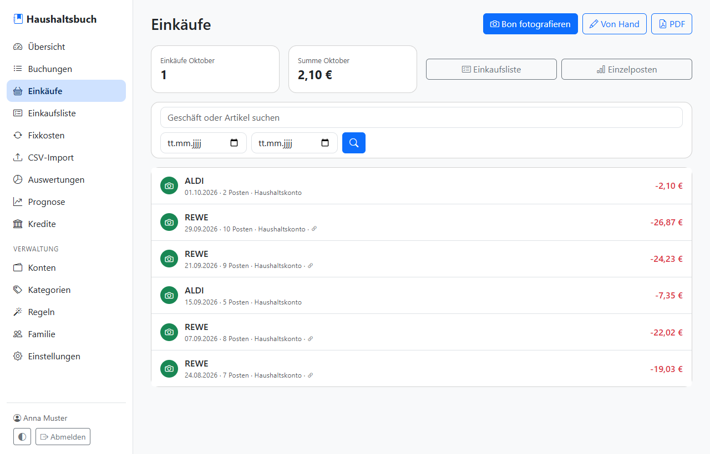

### Kassenbon fotografieren

1. **+ → Bon fotografieren** (oder **Einkäufe → Bon fotografieren**).
2. **Kassenbon fotografieren** öffnet die Kamera. Bei langen Bons mehrere Fotos nacheinander aufnehmen.
   Alternativ **Bild auswählen** für ein vorhandenes Foto.
3. **Erkennen** drücken. Geschäft, Datum, Summe und die einzelnen Posten werden ausgelesen.
   - **Lokal**: Die Erkennung läuft im Browser. Das kostet nichts, und das Foto verlässt das Gerät nicht. Beim ersten
     Mal werden ca. 5 MB Sprachdaten geladen.
   - **KI**: Die Erkennung ist deutlich genauer und schlägt auch Kategorien vor. Das Foto geht dafür an einen KI-Dienst (Claude), was wenige Cent pro Bon kostet.
     Nur verfügbar, wenn der Administrator das eingerichtet hat.
4. Die erkannten Posten **prüfen** und bei Bedarf korrigieren. Weicht die Summe der Posten vom Bon ab, wird das angezeigt.
   Bei der lokalen Erkennung steht oben z. B. „Erkannt: 38 von 47 Posten“. Die Liste folgt dem Bon Zeile für Zeile:
   - **Rot gestrichelt, „Preis?“**: Die Zeile steht auf dem Bon, der Preis war aber nicht lesbar. Darunter steht, was
     gelesen wurde. Preis vom Bon abschreiben – oder die Zeile löschen. Leere Zeilen werden beim Speichern (nach
     Rückfrage) weggelassen.
   - **Gelb umrandeter Preis**: geraten oder auffällig (z. B. 15,00 statt 1,50) – bitte mit dem Bon vergleichen.
5. **Einkauf speichern**.

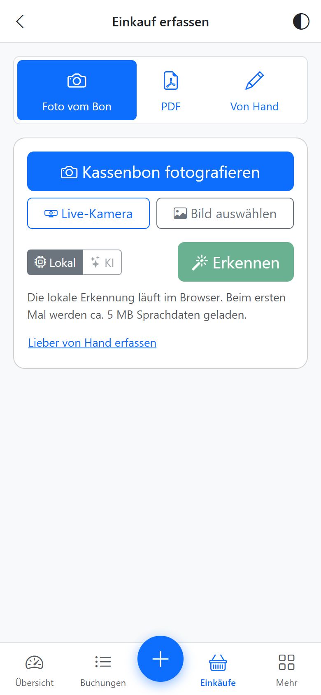

> Die Kamera funktioniert nur, wenn das Haushaltsbuch über **https://** aufgerufen wird.
> Für gute Ergebnisse den Bon glatt auf einen dunklen Untergrund legen und gerade von oben fotografieren.
> Bei langen Bons sollen sich die Fotos etwas überlappen – doppelt erkannte Posten werden automatisch zusammengeführt.

### PDF oder von Hand

- **PDF**: für Online-Rechnungen oder gescannte Belege. Das Einlesen funktioniert wie beim Foto.
- **Von Hand**: Posten mit Namen und Preis eintippen. **Enter** im Preisfeld fügt direkt den nächsten Posten hinzu.
  Du kannst auch ganz ohne Posten nur den Gesamtbetrag erfassen.

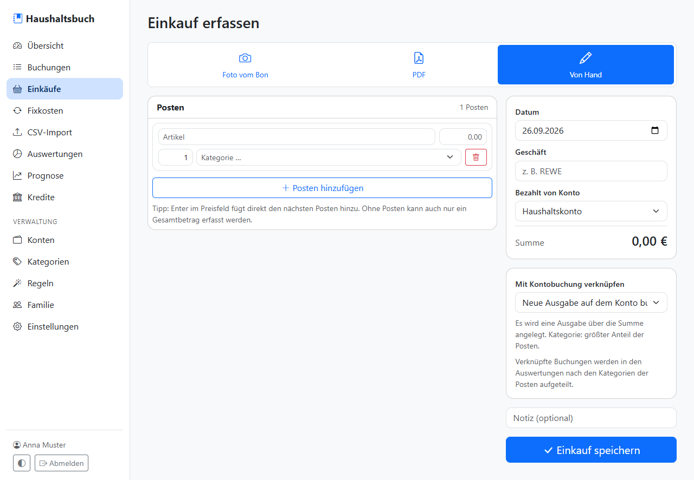

### Mit dem Konto verknüpfen

Unter **Mit Kontobuchung verknüpfen** legst du fest, wie der Einkauf zur Kontobuchung steht:

- **Neue Ausgabe auf dem Konto buchen**: Es wird eine Ausgabe über die Summe angelegt, gut bei Barzahlung.
- **Vorhandene Buchung wählen**: Die Kartenzahlung ist schon da (z. B. aus dem CSV-Import). Passende Buchungen werden vorgeschlagen.
- **Nicht verknüpfen**: Der Einkauf wird nur als Liste festgehalten.

Verknüpfte Buchungen werden in den Auswertungen nach den Kategorien der einzelnen Posten aufgeteilt.
Ein REWE-Einkauf erscheint dann z. B. anteilig unter Lebensmittel und Drogerie.

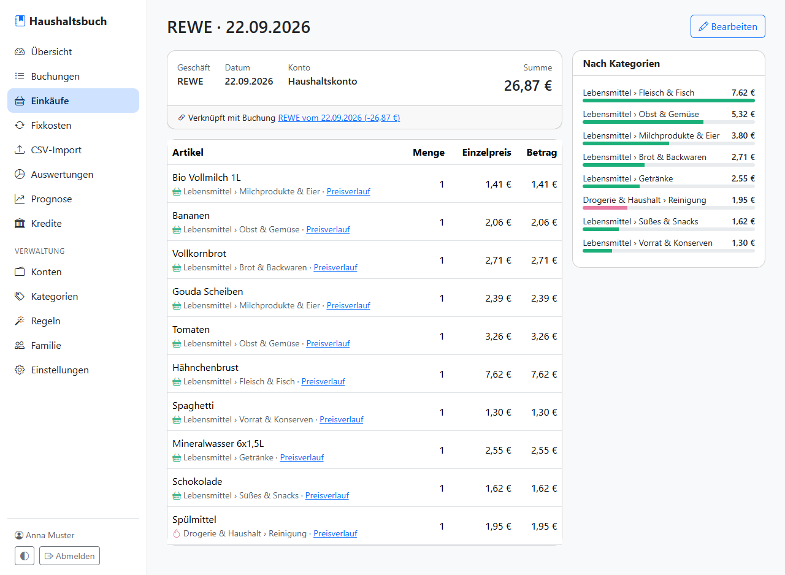

Die Kategorie jedes Artikels merkt sich das Haushaltsbuch. Beim nächsten Einkauf wird „Bananen“ automatisch als
„Obst & Gemüse“ vorgeschlagen. Über **Preisverlauf** siehst du, was ein Artikel wann gekostet hat.

### Einkaufsliste

Unter **Einkaufsliste** (am Handy über **Mehr** oder auf der Seite **Einkäufe**) legst du Listen an, z. B.
„Wocheneinkauf“. Ins Suchfeld tippst du, was du brauchst: Vorgeschlagen werden Posten, die schon einmal auf einer
Liste standen, und Artikel aus deinen bisherigen Einkäufen mit Preisspanne. Gibt es etwas noch nicht, fügst du es
als neuen Posten hinzu. Menge und Einheit (Stück, kg, g, l, ml, Pck.) stellst du vor dem Hinzufügen ein. Steht ein
Posten schon auf der Liste, wird die Menge erhöht.

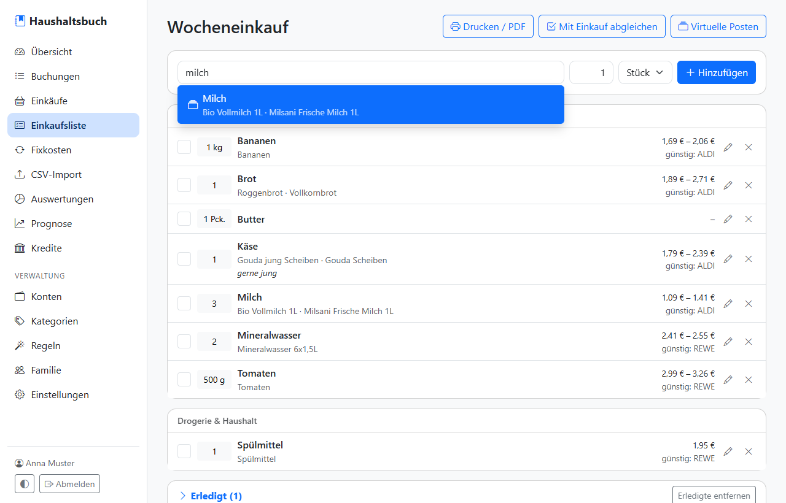

Zu jedem Posten zeigt die Liste den bisher **günstigsten und teuersten Preis** und den Laden mit dem besten Preis.
Die Posten sind nach Kategorie gruppiert, so findest du im Laden alles in einem Gang. Ein Tipp auf die Menge oder
den Stift öffnet die Bearbeitung. Dort änderst du Menge und Einheit, trägst eine Notiz ein (z. B. „Bio“) oder
springst mit **Virtuellen Posten bearbeiten** zu Name, Kategorie und Produkten des Postens. Mit dem Kästchen hakst
du einen Posten von Hand ab.

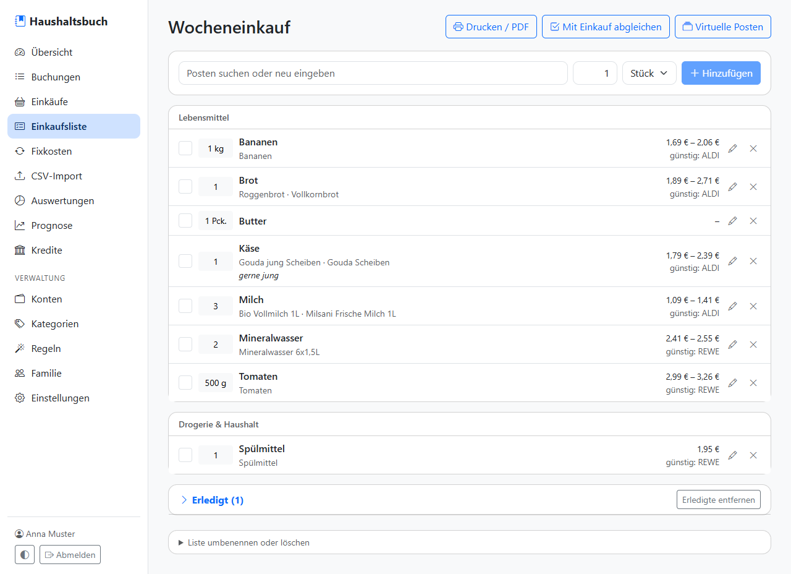

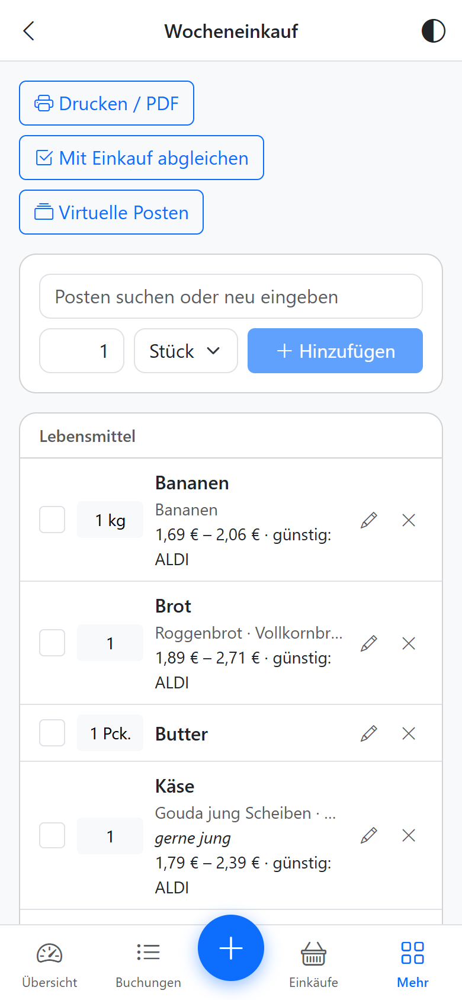

**Drucken / PDF** öffnet eine Druckansicht mit Kästchen zum Abhaken. Im Druckdialog kannst du **Als PDF speichern**
wählen.

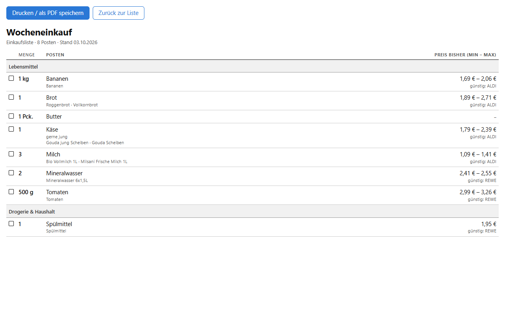

**Nach dem Einkauf:** Sobald du den Kassenbon erfasst, hakt das Haushaltsbuch die gekauften Posten automatisch ab.
Ein Hinweis zeigt, wie viele es waren. Das gilt für Posten, die spätestens am Einkaufstag auf die Liste kamen, alte
Bons haken also nichts ab. Mit **Mit Einkauf abgleichen** kannst du eine Liste auch gezielt mit einem Einkauf der
letzten 30 Tage vergleichen. Abgehakte Posten wandern nach unten unter **Erledigt**, mit Link zum Einkauf. Mit
**Erledigte entfernen** räumst du die Liste auf.

#### Virtuelle Posten: dasselbe Produkt aus verschiedenen Läden

Ein Posten auf der Liste ist ein **virtueller Posten**, z. B. „Milch“. Ihm sind die echten Artikel von deinen Bons
zugeordnet, etwa „Bio Vollmilch 1L“ von REWE und „Milsani Frische Milch 1L“ von ALDI. Die Preisspanne gilt für alle
zugeordneten Artikel, und der Kauf eines davon hakt „Milch“ ab.

Über den Knopf **Virtuelle Posten** auf der Einkaufsliste öffnest du einen Posten mit einem Tipp. Dort kannst du ihn
umbenennen, die Kategorie ändern und Artikel aus deinen Einkäufen hinzufügen oder entfernen. Mit
**Zurück zu „…“** kommst du wieder zu der Liste, die du zuletzt offen hattest.

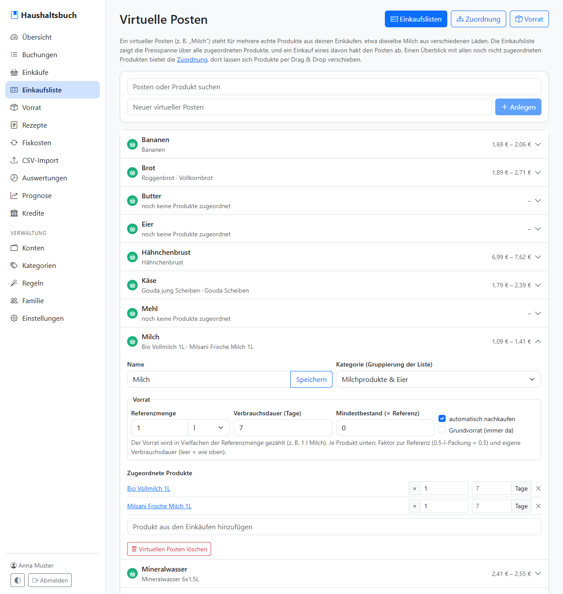

Das meiste passiert von selbst:

- Wählst du beim Hinzufügen einen Artikel aus deinen Einkäufen, entsteht ein virtueller Posten mit diesem Artikel.
  Gehört der Artikel schon zu einem virtuellen Posten, wird dieser verwendet.
- Ein neuer Posten wie „Butter“ wird beim ersten Einkauf von „Butter 250g“ abgehakt, weil der Name ohne
  Mengenangabe übereinstimmt. Der Artikel wird ihm dabei zugeordnet.
- Ähnliche Namen wie „Milchschokolade“ zählen **nicht** als „Milch“. Solche Artikel ordnest du bei Bedarf von Hand zu.

#### Zuordnung auf einen Blick

Die Seite **Zuordnung** (Knopf auf der Seite **Virtuelle Posten**) zeigt links alle virtuellen Posten mit ihren
Artikeln und rechts alle Artikel aus deinen Einkäufen, die noch keinem Posten zugeordnet sind. Die meistgekauften
stehen oben.

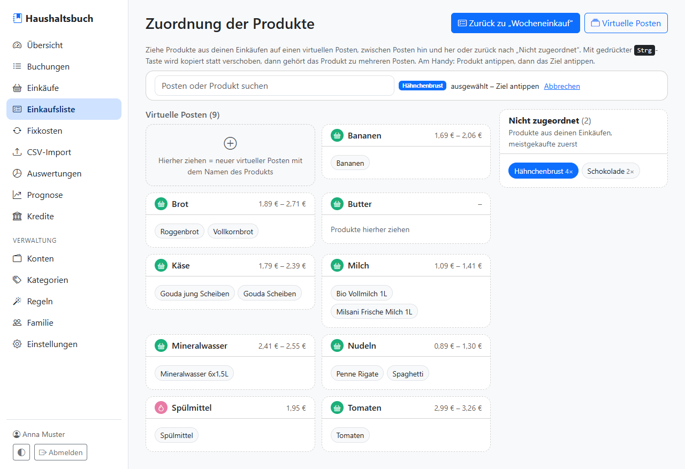

- **Ziehen und ablegen:** Einen Artikel auf einen virtuellen Posten ziehen ordnet ihn zu. Zwischen zwei Posten wird
  er verschoben, zurück nach **Nicht zugeordnet** wird die Zuordnung gelöst.
- **Neuer Posten:** Ziehst du einen Artikel auf das Feld mit dem Plus, entsteht ein neuer virtueller Posten mit dem
  Namen des Artikels. Den Namen kannst du danach ändern, z. B. „Hähnchenbrust 400g“ in „Hähnchen“.
- **Mit gedrückter Strg-Taste** wird kopiert statt verschoben. Dann gehört der Artikel zu mehreren Posten.
- **Am Handy:** Artikel antippen (er wird blau markiert), dann das Ziel antippen.
- Das Suchfeld filtert beide Seiten.

---

## 7. Vorrat und Rezepte

Das Haushaltsbuch kann mitzählen, was zu Hause ist. Es schlägt Rezepte vor, die du damit kochen kannst, und setzt
Fehlendes auf die Einkaufsliste. Grundlage sind die [virtuellen Posten](#virtuelle-posten-dasselbe-produkt-aus-verschiedenen-läden)
der Einkaufsliste, z. B. „Milch“ oder „Mehl“.

### Vorrat einrichten

Öffne unter **Einkaufsliste → Virtuelle Posten** einen Posten. Im Bereich **Vorrat** stellst du ein:

- **Referenzmenge**: die Menge, in der der Vorrat gezählt wird, z. B. 1 l bei Milch, 1 kg bei Mehl oder 1 Stück bei Eiern.
- **Verbrauchsdauer (Tage)**: wie lange es normalerweise dauert, bis der Posten verbraucht oder abgelaufen ist.
  Leer heißt, er läuft nicht ab, z. B. Nudeln oder Mineralwasser.
- **Mindestbestand**: ab wann nachgekauft werden soll, in Vielfachen der Referenzmenge. 0 heißt erst, wenn nichts
  mehr da ist.
- **automatisch nachkaufen**: ob der Posten auf die automatische Einkaufsliste kommt.
- **Grundvorrat (immer da)**: für Salz, Pfeffer oder Öl. Er gilt in Rezepten immer als vorhanden und wird nicht gezählt.

Bei den **zugeordneten Produkten** steht je Artikel ein **Faktor** zur Referenzmenge. Eine 0,5-l-Packung Milch hat
bei 1 l Referenz den Faktor 0,5, ein Sixpack „Mineralwasser 6x1,5L“ bei 1,5 l Referenz den Faktor 6. Steht die
Packungsgröße im Namen, schlägt das Haushaltsbuch den Faktor vor. Ein Klick auf **Vorschlag** übernimmt ihn. Daneben
kannst du für einen Artikel eine eigene **Verbrauchsdauer** eintragen, z. B. H-Milch 30 Tage statt 7.

### Der Vorrat

Unter **Vorrat** siehst du je Posten den Bestand und seinen Zustand:

| Zustand | Bedeutung |
|---|---|
| **vorrätig** | Es ist genug da. |
| **knapp** | Der Bestand liegt auf oder unter dem Mindestbestand. |
| **aufgebraucht** | Es ist nichts mehr da: verbraucht, gekocht oder von Hand auf 0 gesetzt. |
| **abgelaufen** | Die letzte Packung hat ihre Verbrauchsdauer überschritten. |
| **Grundvorrat** | Der Posten ist immer da und wird nicht gezählt. |

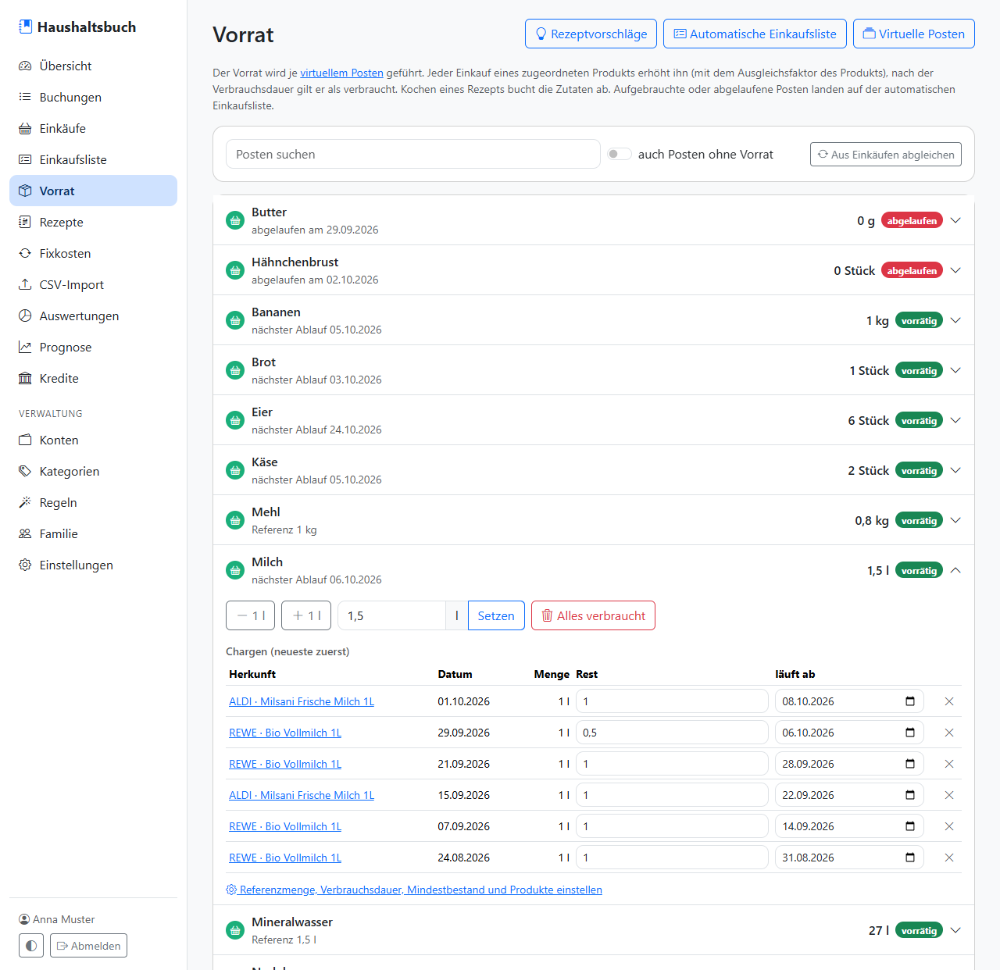

So ändert sich der Vorrat:

- **Einkauf:** Jeder gespeicherte Einkauf erhöht den Vorrat der zugeordneten Posten, z. B. 2 × „Milch 0,5l“ um 1 l.
  Jeder Kauf ist eine eigene **Charge** mit Ablaufdatum (Kaufdatum + Verbrauchsdauer). Bearbeitest du einen Einkauf
  später, wird nichts doppelt gezählt.
- **Ablauf:** Nach der Verbrauchsdauer zählt eine Charge als verbraucht.
- **Kochen:** **Gekocht** bei einem Rezept bucht die Zutaten ab. Dabei wird zuerst die Charge verbraucht, die als
  Nächstes abläuft.
- **Von Hand:** Ein Tipp auf den Posten öffnet **− / +** (je eine Referenzmenge), **Setzen** für einen genauen
  Bestand und **Alles verbraucht**. In der Liste der Chargen lassen sich Restmenge und Ablaufdatum ändern, z. B.
  wenn der Joghurt länger hält.

Am Anfang ist der Vorrat leer. **Aus Einkäufen abgleichen** übernimmt die Einkäufe der letzten 90 Tage. Ältere Chargen
sind dann meist schon abgelaufen. Danach lohnt ein kurzer Blick, ob die Bestände stimmen.

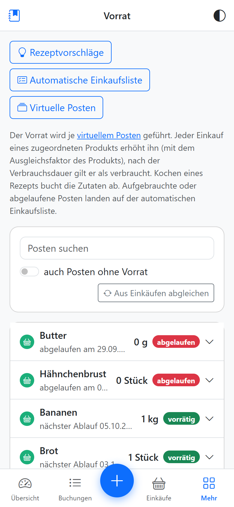

### Automatische Einkaufsliste

Ist ein Posten aufgebraucht, abgelaufen oder knapp, setzt das Haushaltsbuch ihn auf die Liste **Automatisch**. Die
Notiz zeigt den Grund, z. B. „abgelaufen am 29.09.“. Die Menge ist eine Referenzmenge oder so viel, wie bis zum
Mindestbestand fehlt. Speicherst du den Einkauf, wird der Posten wie auf jeder Liste abgehakt. Füllst du den Vorrat
von Hand auf, verschwindet er wieder. Hakst du ihn von Hand ab, kommt er erst wieder auf die Liste, wenn er erneut
ausgeht. Die Prüfung läuft beim ersten Aufruf am Tag sowie nach jedem Einkauf, Kochen und jeder Korrektur.

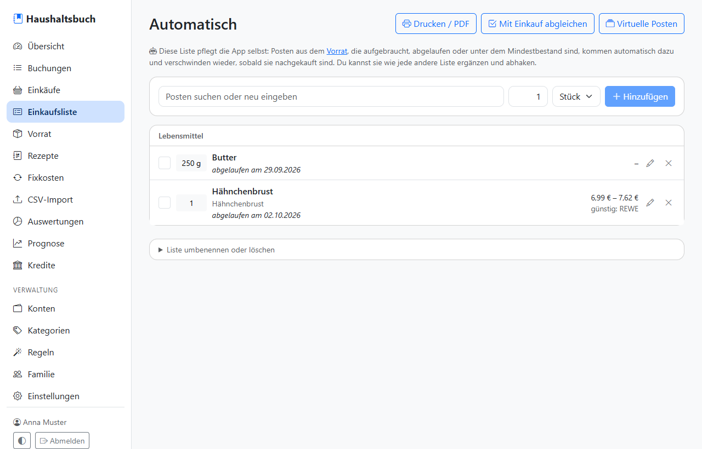

### Rezepte

Unter **Rezepte** legst du mit **Neues Rezept** ein Rezept an:

- **Name** und **Portionen**: für wie viele Personen die Mengen gedacht sind.
- **Klassifikation**: z. B. Mahlzeit *morgens / mittags / abends*. Ein Rezept kann mehrere Werte haben. Eigene Gruppen
  wie *Art: vegetarisch / mit Fleisch* legst du unter **Klassifikation** an.
- **Zutaten**: je Zeile ein virtueller Posten mit Menge und Einheit, optional eine Notiz („gehackt“, „1 Prise“). Beim
  Tippen erscheinen die vorhandenen Posten. Ein neuer Name wird als virtueller Posten angelegt. Die Einheit muss zur
  Referenz passen: Bei Mehl (1 kg) gehen g und kg, bei Eiern (Stück) nur Stück.
- **Zubereitung**: freier Text.

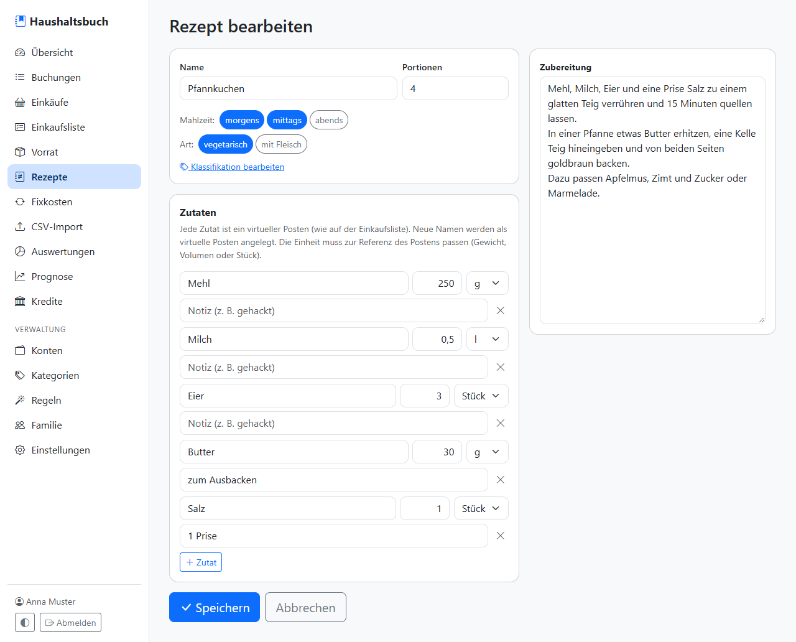

In der Ansicht eines Rezepts rechnest du die Mengen auf eine andere **Portionenzahl** um. Die Zutatenliste zeigt
dabei, was vorhanden ist und was fehlt. **Gekocht – vom Vorrat abbuchen** zieht die Zutaten für die gewählten
Portionen ab. **Fehlendes auf Liste** setzt die fehlenden Zutaten auf eine Einkaufsliste deiner Wahl, aufgerundet
auf ganze Referenzmengen, z. B. eine Packung Butter.

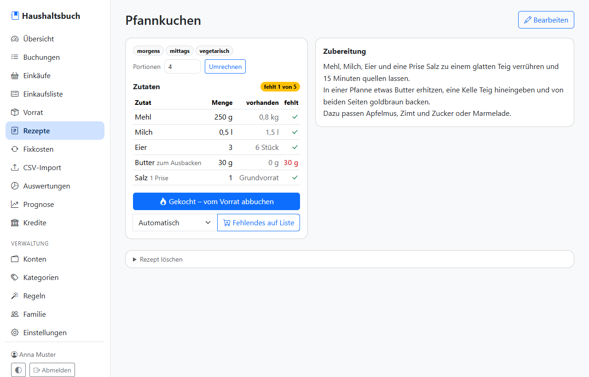

### Rezeptvorschläge

**Rezeptvorschläge** zeigt zuerst alle Rezepte, die mit dem aktuellen Vorrat **vollständig machbar** sind. Mit
**Weitere Vorschläge** kommen jeweils zehn weitere dazu, sortiert nach den wenigsten fehlenden Zutaten. Jede Karte
zeigt, wie viele Zutaten fehlen („fehlt 1 von 5“). Der Balken zeigt, wie viel der Vorrat schon abdeckt. Ein Tipp auf
das Rezept klappt die Zutaten mit *benötigt / vorhanden / fehlt* auf. Mit **Fehlendes auf Einkaufsliste** landen die
fehlenden Zutaten auf der oben gewählten Liste.

Oben filterst du nach Klassifikation, z. B. nur *abends* und *vegetarisch*. Innerhalb einer Gruppe reicht einer der
gewählten Werte. Mit **Portionen** rechnest du alle Vorschläge auf eine Personenzahl um.

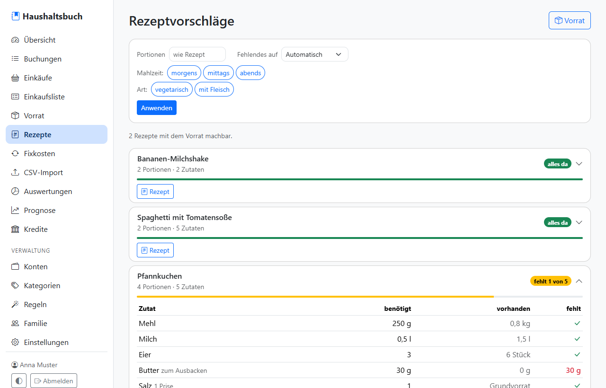

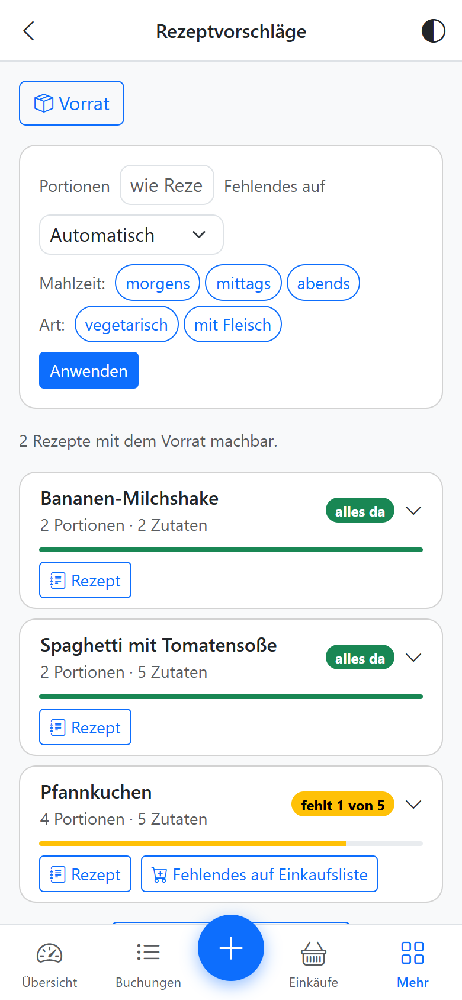

---

## 8. Fixkosten und Daueraufträge

Unter **Fixkosten** stehen alle regelmäßigen Zahlungen: Miete, Strom, Versicherungen, Abos, Gehalt, Kindergeld,
Sparraten usw.

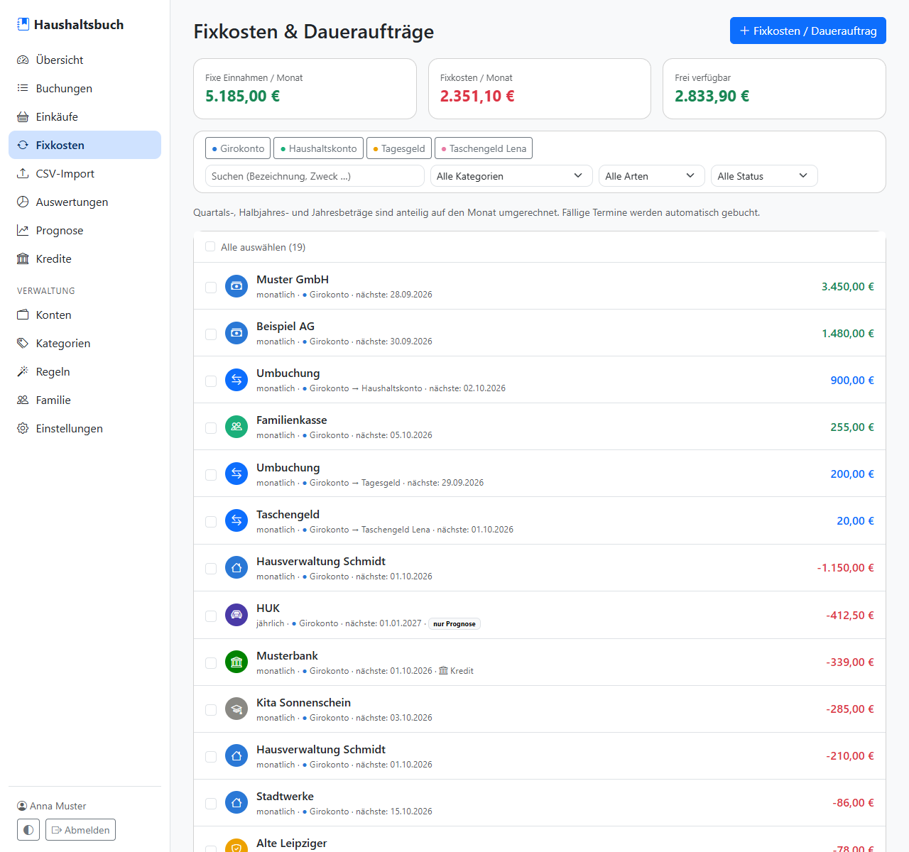

Oben siehst du die **fixen Einnahmen**, die **Fixkosten pro Monat** und was **frei verfügbar** bleibt. Vierteljährliche und
jährliche Beträge werden dafür auf den Monat umgerechnet.

**Neu anlegen:** **+ Fixkosten / Dauerauftrag**. Dort Art, Betrag, Bezeichnung, Konto, Kategorie, **Intervall**
(monatlich, vierteljährlich, halbjährlich, jährlich) und **erste Fälligkeit** eingeben. Der Tag der ersten Fälligkeit ist
der Buchungstag. Bei „31.“ wird in kürzeren Monaten der Monatsletzte genommen.

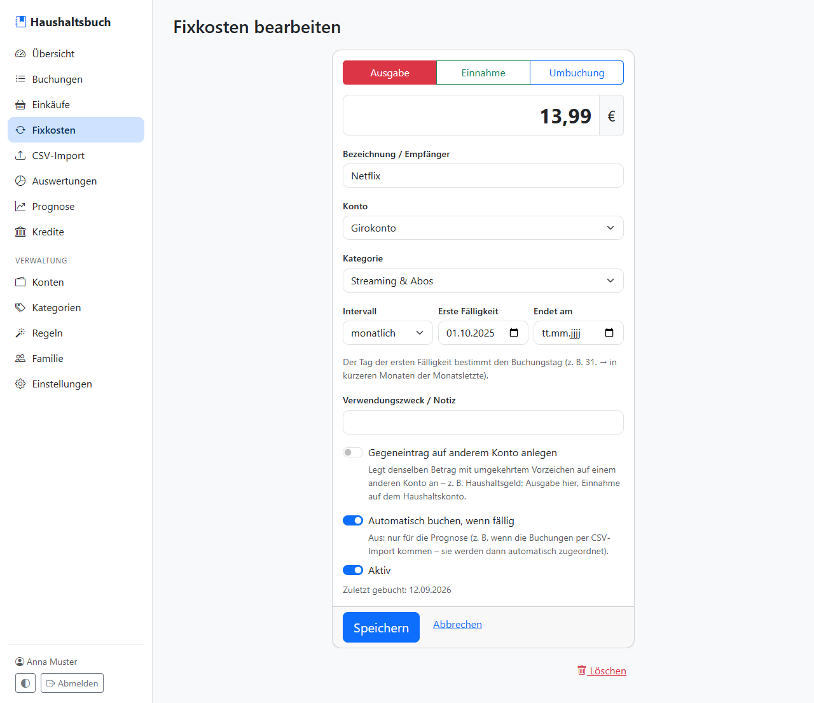

- **Automatisch buchen, wenn fällig**: Das Haushaltsbuch legt die Buchung am Fälligkeitstag selbst an.
  Schalte das **aus**, wenn die Umsätze ohnehin per CSV-Import kommen. Dann dient die Vorlage nur der Prognose, und
  importierte Buchungen werden ihr automatisch zugeordnet.
- **Aktiv** aus = pausiert (z. B. gekündigtes Abo). Mit **Endet am** hört eine Zahlung zu einem Datum auf.
- **Gegeneintrag auf anderem Konto anlegen**: Legt denselben Betrag mit umgekehrtem Vorzeichen auf einem anderen Konto
  an, z. B. Haushaltsgeld: Ausgabe auf dem Gehaltskonto, Einnahme auf dem Haushaltskonto.

Auch hier gibt es Filter und Häkchen für **Sammelaktionen** (nur Prognose / automatisch, pausieren, anderem Konto
zuweisen). Buchungen, die zu Fixkosten gehören, sind in der Buchungsliste gekennzeichnet.

---

## 9. Kategorien und Regeln

### Kategorien

Kategorien gibt es in zwei Ebenen, z. B. **Lebensmittel › Obst & Gemüse**. Sie gelten für Buchungen und für
Einkaufsposten. Ein Standardsatz ist bereits angelegt. Administratoren können Kategorien umbenennen, einfärben, neue
anlegen (**+** neben einer Hauptkategorie für eine Unterkategorie) und löschen.

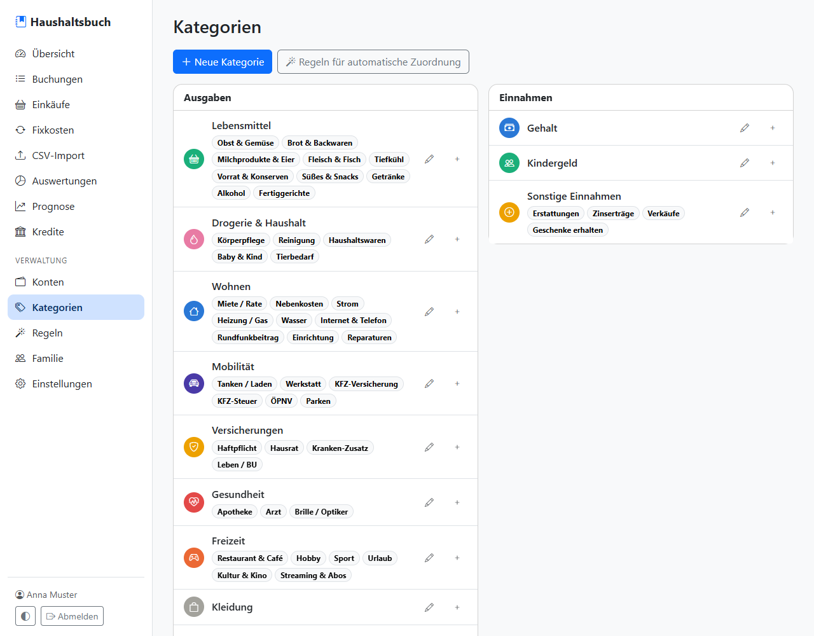

Beim Bearbeiten einer Kategorie gibt es die Option **„In der Prognose ausklammern“**. Sie ist für Einmaliges gedacht,
etwa eine neue Waschmaschine oder den Urlaub, das die Prognose sonst verzerren würde (siehe [Prognose](#11-prognose)).

### Wie Kategorien automatisch vergeben werden

Bei jeder neuen Buchung und jedem Einkaufsposten schlägt das Haushaltsbuch eine Kategorie vor, in dieser Reihenfolge:

1. **Eigene Regeln** (siehe unten),
2. **Gelerntes**: Was du beim gleichen Empfänger oder Produkt schon einmal gewählt hast,
3. **Eingebaute Stichwörter** (z. B. „Aral“ → Tanken, „dm“ → Drogerie).

Korrigierst du einen Vorschlag, merkt sich das Haushaltsbuch die Korrektur.

### Regeln

Unter **Regeln** legst du fest: *Wenn Empfänger/Zweck/Artikel … enthält / genau ist / beginnt mit …, dann Kategorie …*.
Bei mehreren passenden Regeln gewinnt die mit der kleinsten Priorität. **Auf Buchungen ohne Kategorie anwenden**
ordnet mit den Regeln nachträglich alle noch offenen Buchungen zu.

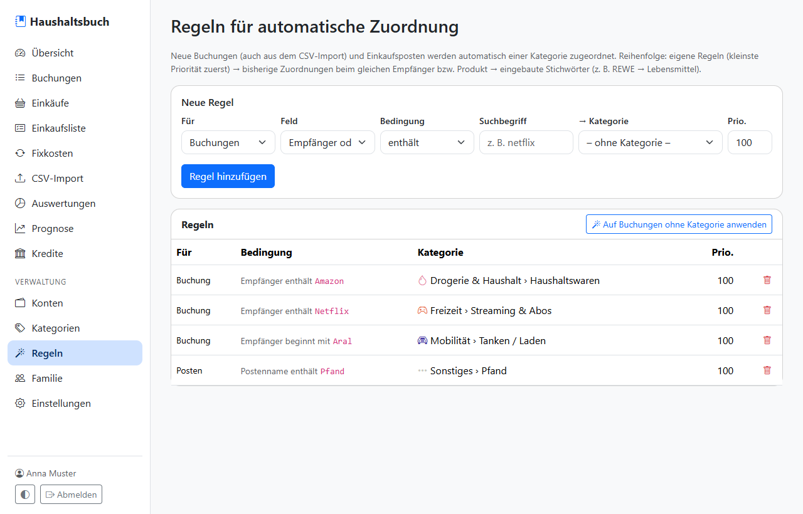

---

## 10. Auswertungen

Unter **Auswertungen** siehst du, wofür das Geld ausgegeben wird.

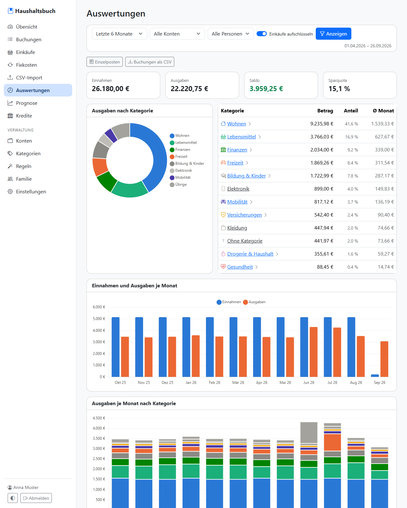

- Oben **Zeitraum**, **Konten** und **Person** wählen und **Anzeigen** drücken.
- **Einkäufe aufschlüsseln**: Verknüpfte Einkäufe werden nach ihren Posten aufgeteilt statt als Ganzes gezählt.
- **Einnahmen, Ausgaben, Saldo und Sparquote** für den Zeitraum.
- **Ausgaben nach Kategorie** als Ring und Tabelle. Eine Kategorie anklicken zeigt ihre Unterkategorien, von dort
  geht es zu den einzelnen Buchungen.
- **Einnahmen und Ausgaben je Monat** und **Ausgaben je Monat nach Kategorie** zeigen den Verlauf.
- **Buchungen als CSV** lädt die Buchungen des Zeitraums für Excel herunter.

Umbuchungen zwischen eigenen Konten zählen normalerweise nicht mit. Filterst du auf einzelne Konten, zählen sie als
Einnahme bzw. Ausgabe (eigene Zeile „Umbuchungen“), damit die Bilanz dieses Kontos stimmt.

### Einzelposten

**Einzelposten** (Knopf oben bzw. **Mehr → Einzelposten**) wertet die Einkäufe nach Artikeln aus: wie oft gekauft,
Durchschnittspreis, günstigster und teuerster Preis. Ein Artikel anklicken zeigt seinen **Preisverlauf**.

Unter dem Filter steht der **Kategorie-Pfad** mit der Summe aller gefundenen Posten. Ein Klick auf „Alle Kategorien“,
die Hauptkategorie oder den Pfeil links führt eine Ebene höher. In einer Hauptkategorie erscheinen ihre
Unterkategorien grau darunter (mit Summe) – ein Klick filtert darauf. Die Auswahl **Ohne Kategorie** im Filter zeigt
Posten, denen noch keine Kategorie zugeordnet ist.

**Kategorie korrigieren:** Steht ein Artikel in der falschen Kategorie, auf die Kategorie unter dem Artikelnamen
(mit dem Stift) tippen, die richtige wählen und **Speichern**. Das ändert alle Käufe dieses Artikels und merkt sich die
Kategorie für künftige Einkäufe.

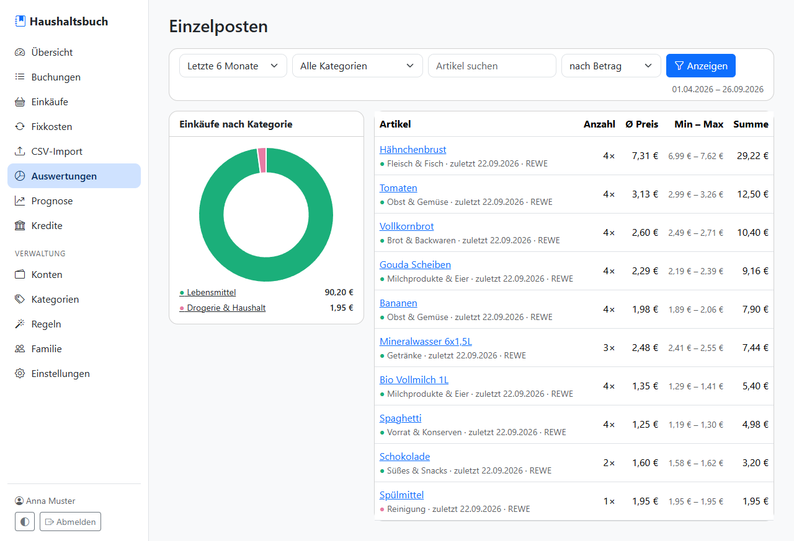

---

## 11. Prognose

Die **Prognose** zeigt, wie sich die Kontostände in den nächsten 3 bis 36 Monaten voraussichtlich entwickeln.

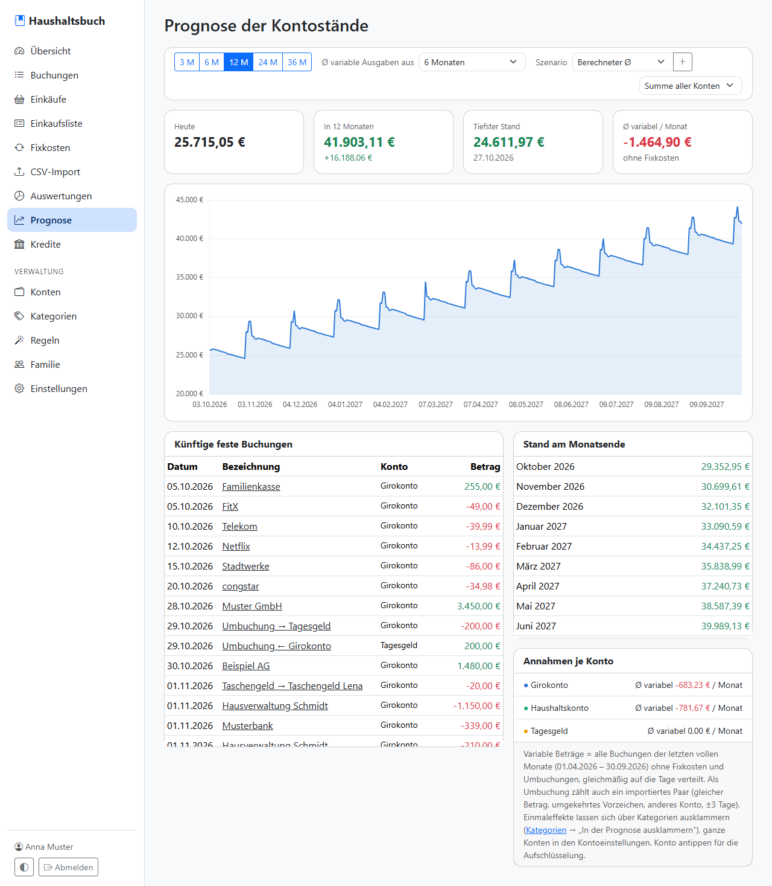

So wird gerechnet:

- Ausgangspunkt ist der **Kontostand heute**.
- Dazu kommen alle **Fixkosten** an ihren Terminen und die noch nicht gebuchten **Budgets aus dem Kalender**
  (Liste „Künftige feste Buchungen und Kalender-Budgets“, siehe [Kalender](#12-kalender)).
- Alles Übrige, also Einkäufe, Tanken, Freizeit usw., fließt als **Durchschnitt der letzten Monate** ein
  („Ø variabel / Monat“, einstellbar: aus wie vielen Monaten).

Im Diagramm siehst du den Verlauf, rechts den **Stand am Monatsende**. Rutscht der Gesamtsaldo voraussichtlich ins Minus,
warnt die Prognose mit einem roten Hinweis. Über das Auswahlfeld rechts oben kannst du statt der Summe einzelne Konten ansehen.
Unter **Annahmen je Konto** steht, welcher Durchschnitt verwendet wird. Ein Klick darauf zeigt die Aufschlüsselung.

> Verzerrt eine einmalige große Ausgabe den Durchschnitt, die Kategorie unter **Kategorien** mit
> „In der Prognose ausklammern“ markieren. Kreditraten zählen nur mit, wenn sie als Fixkosten angelegt sind (siehe [Kredite](#13-kredite)).

### Szenarien: „Was wäre, wenn …?“

Mit **+** neben **Szenario** legst du ein Szenario an, z. B. „Sparsamer Monat“. Darin trägst du je Konto einen
eigenen Monatswert für die variablen Ausgaben ein. Ein leeres Feld heißt: Es gilt der berechnete Durchschnitt.
Wählst du das Szenario aus, läuft der berechnete Durchschnitt als gestrichelte Vergleichslinie mit.

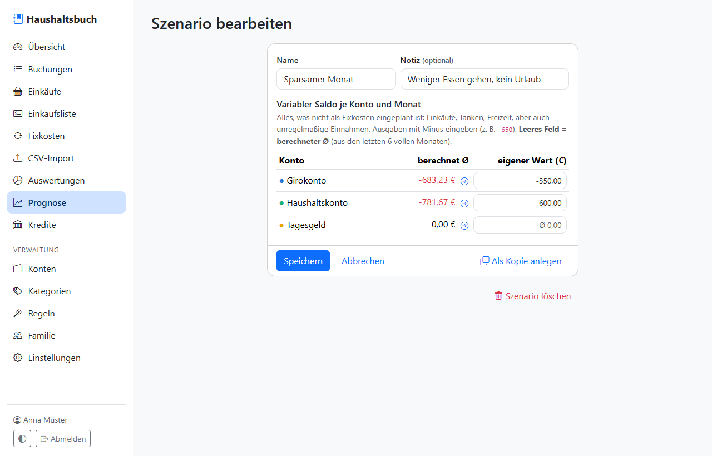

---

## 12. Kalender

Unter **Kalender** hat jedes Familienmitglied seinen eigenen Kalender. Darin stehen alle Termine, die du selbst
angelegt hast, und alle, zu denen dich jemand als **Teilnehmer** eingetragen hat.

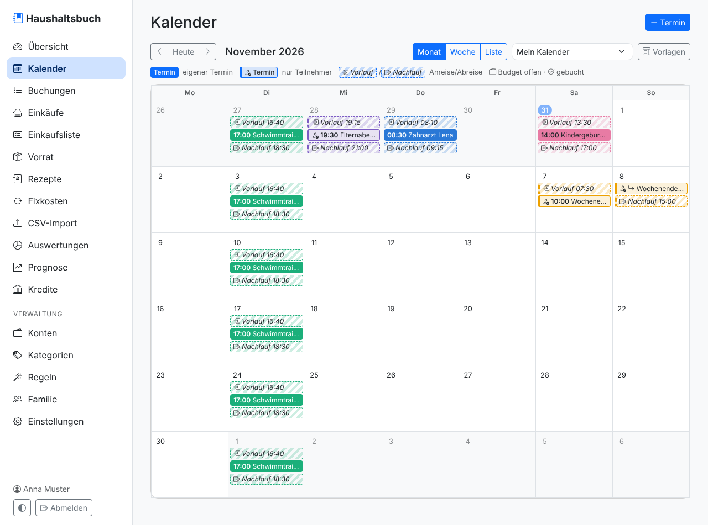

- **Eigene Termine** sind farbig gefüllt. Termine, bei denen du **nur Teilnehmer** bist, sind hell mit farbigem Rand und
  tragen ein Personen-Symbol mit Haken; in der Liste steht dazu „Teilnehmer · von …“.
- **Vorlauf** (z. B. Anreise) und **Nachlauf** (z. B. Abreise) gehören zum Termin, erscheinen aber **schraffiert und
  gestrichelt** direkt davor bzw. danach – so siehst du sofort, wann du wirklich losmusst und wann du wieder zurück bist.
- Oben wechselst du zwischen **Monat**, **Woche** und **Liste**; mit dem Auswahlfeld siehst du auch den Kalender eines
  anderen Familienmitglieds (Budgets anderer bleiben dabei verborgen).
- Ein Klick auf eine Tageszahl legt dort einen neuen Termin an, ein Klick auf einen Termin öffnet seine Details.
- Von den Details, den Vorlagen und den Formularen führt der Pfeil **‹** links neben der Überschrift (bzw. oben in der
  Kopfzeile am Handy) oder **Zum Kalender** zurück – und zwar in die zuletzt gewählte Ansicht (Monat, Woche, Liste,
  Kalender eines anderen Mitglieds), beim Termin direkt an dessen Tag.

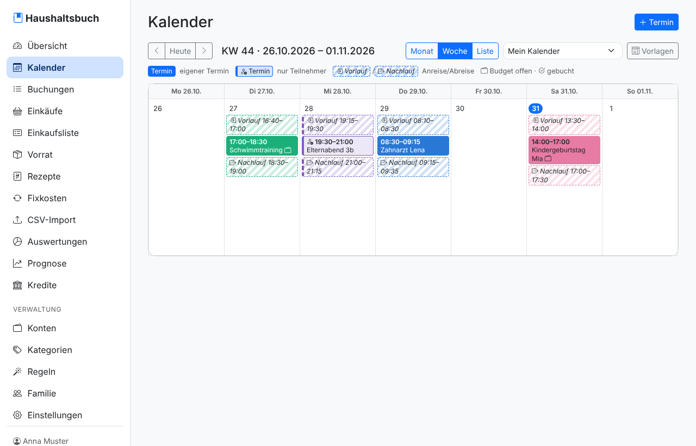

Auf dem Handy zeigt der Kalender die Termine als Liste, Vor- und Nachlauf eingerückt:

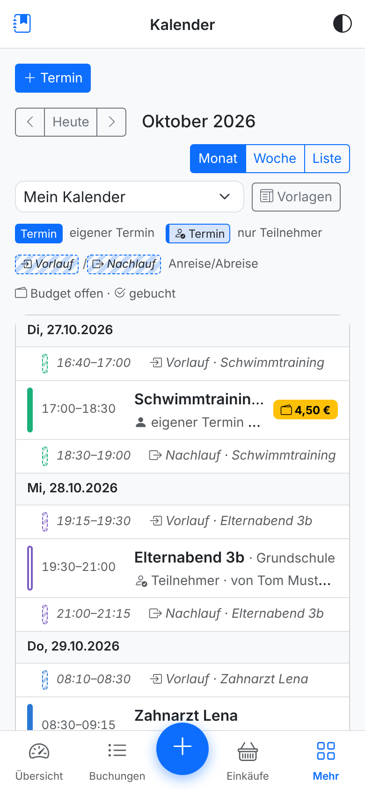

### Termin anlegen

**+ Termin** öffnet das Formular: Titel, Beginn und Ende (oder **ganztägig**), Vor- und Nachlauf, Ort, Wiederholung
(täglich, wöchentlich, monatlich, jährlich – auch „alle 2 Wochen“ und mit Enddatum), Teilnehmer und Notiz.
Vor- und Nachlauf gibst du frei ein: „30 min“, „1:15“, „2 h“ oder „1 Tag“. Verschiebst du den Beginn, wandert das Ende
mit, die Dauer bleibt gleich.

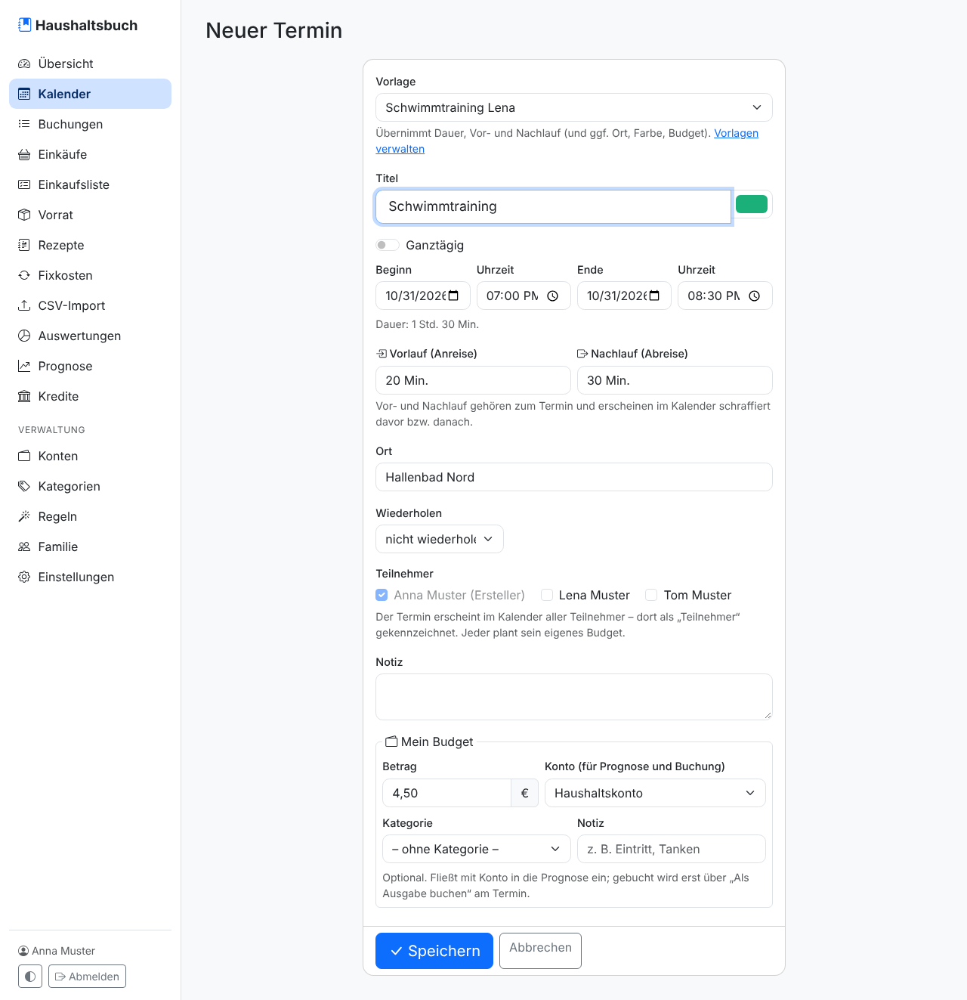

**Teilnehmer**: Hake an, wer dabei ist. Der Termin erscheint dann auch in deren Kalendern. Ändern oder löschen kann ihn
nur, wer ihn angelegt hat (und Administratoren).

### Vorlagen

Unter **Vorlagen** speicherst du Terminarten, die öfter vorkommen – z. B. „Schwimmtraining: 1:30, 20 Min. Anfahrt,
30 Min. Heimweg“. Eine Vorlage enthält **Dauer**, **Vorlauf** und **Nachlauf**, dazu optional Titel, Ort, Farbe und einen
**Budget-Vorschlag**. Wählst du sie im Terminformular aus, werden die Werte übernommen; ändern kannst du danach alles.
Vorlagen sind persönlich – jedes Familienmitglied hat seine eigenen.

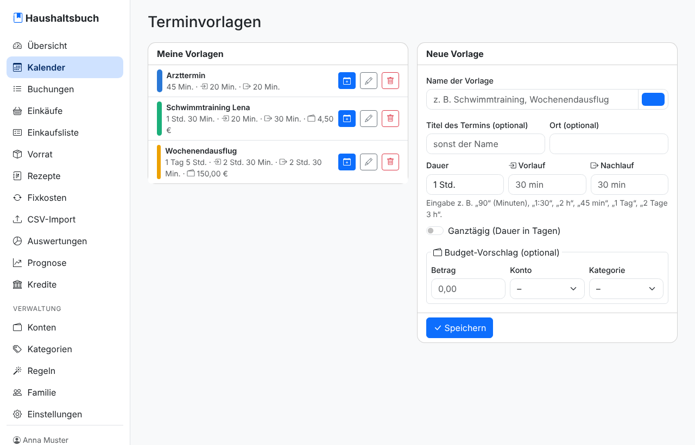

### Budgets

Zu jedem Termin kann **jeder Teilnehmer sein eigenes Budget** planen: Betrag, Konto, Kategorie und Notiz – z. B. 25 €
für ein Geburtstagsgeschenk. Bei Terminserien gilt das Budget **je Termin**.

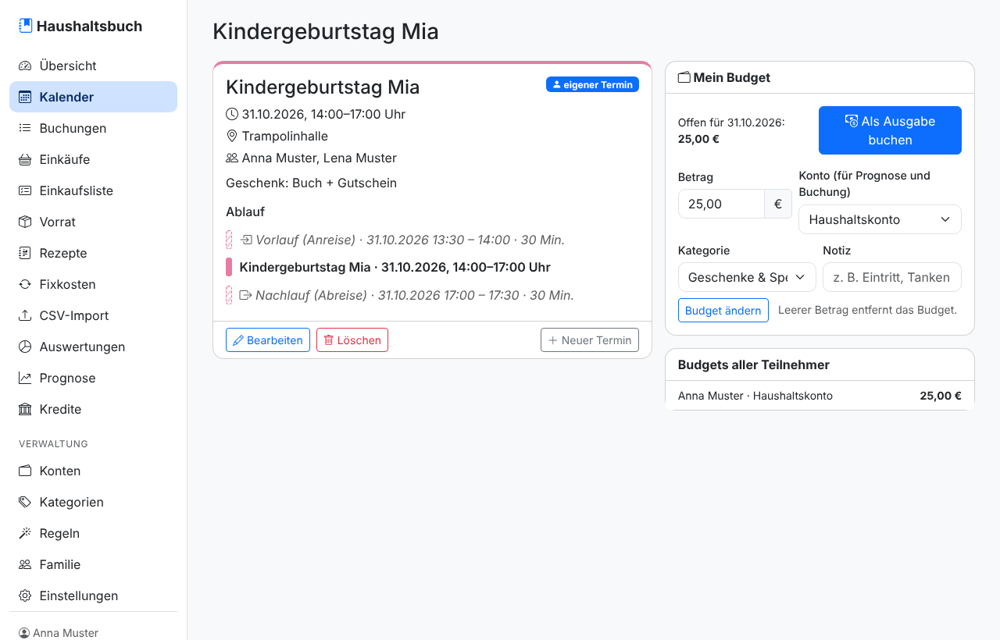

- Solange noch kein Budget geplant ist, steht am Termin unter **Mein Budget** das Formular mit **Budget planen**.
- Ist ein Budget geplant, siehst du stattdessen Betrag, Konto, Kategorie und Notiz. Mit dem **Stift** öffnest du das
  Formular zum Ändern (**Abbrechen** schließt es wieder), mit dem **X** entfernst du das Budget. Ist es schon gebucht,
  bleibt es erhalten, bis die Buchung gelöscht ist.

- Budgets mit Konto fließen in die **[Prognose](#11-prognose)** ein (Liste „Künftige feste Buchungen und
  Kalender-Budgets“). Ohne Konto werden sie nur angezeigt.
- Gebucht wird **nicht automatisch**. Mit **Als Ausgabe buchen** am Termin öffnet sich die Buchung mit dem geplanten
  Betrag – den kannst du vor dem Buchen noch ändern, ebenso Konto, Datum und Kategorie.
- Danach ist das Budget für diesen Termin „gebucht“ und zählt in der Prognose nicht mehr doppelt. Löschst du die
  Buchung wieder, ist das Budget erneut offen.
- Ist ein Termin vorbei und das Budget noch nicht gebucht, rechnet die Prognose es vorsichtshalber für morgen ein.

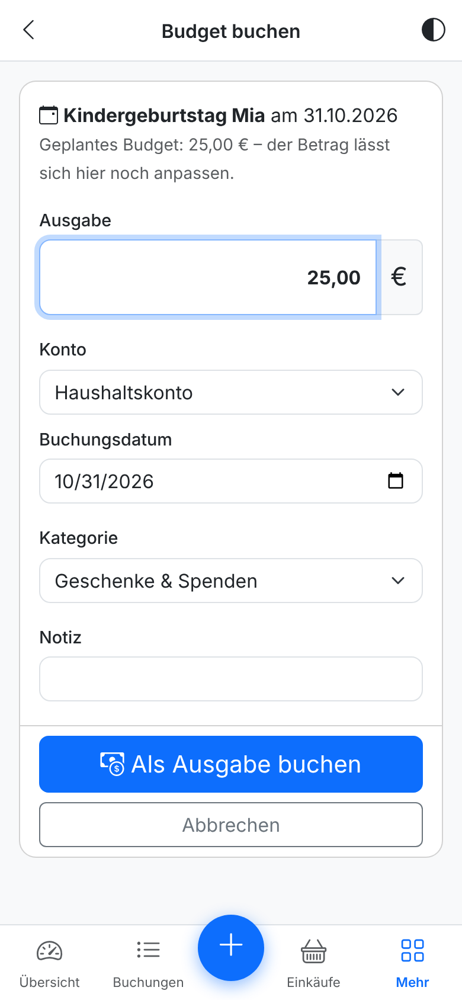

> Tipp: Unter **Einstellungen › Vorzugskonten** legst du mit „Kalender-Budget – Konto“ fest, welches Konto neue Budgets
> vorschlagen.

---

## 13. Kredite

Unter **Kredite** verwaltest du Darlehen (Annuitäten- oder Tilgungsdarlehen) mit Zinssatz, Rate, Auszahlung und
erster Rate.

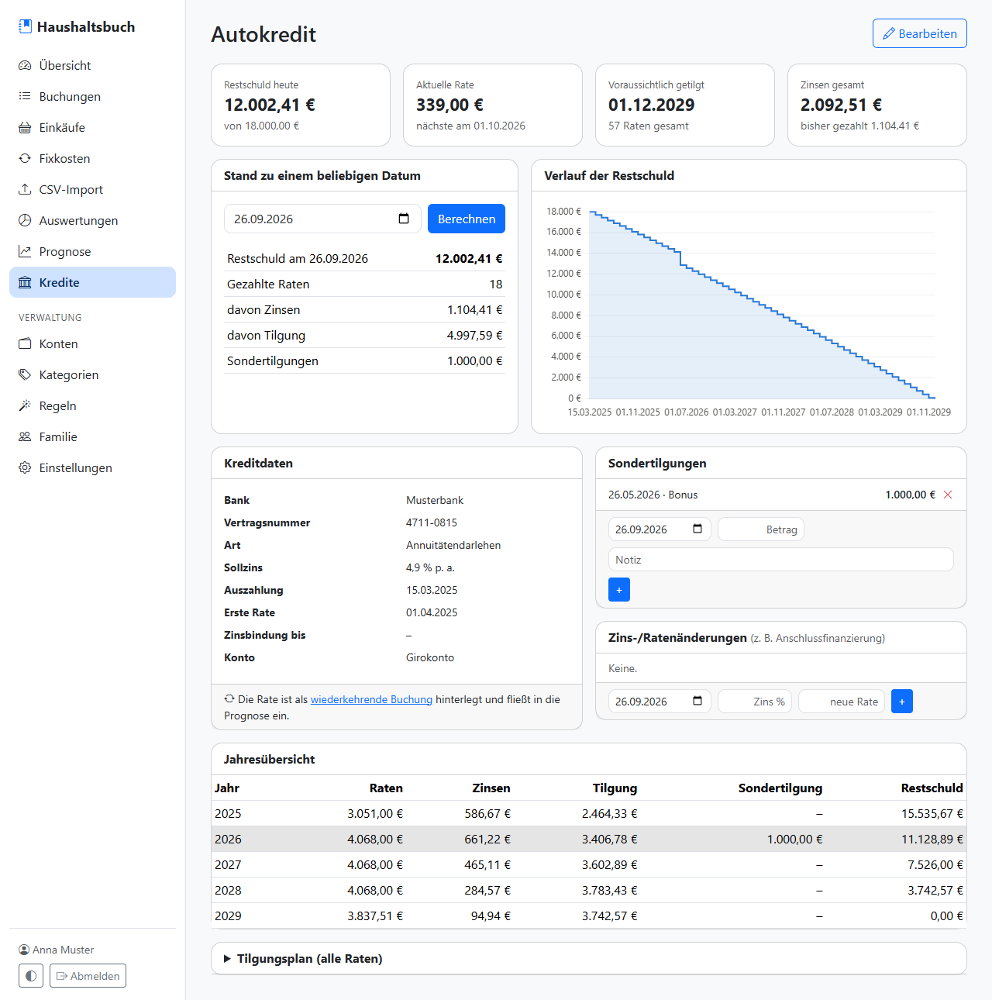

- **Stand zu einem beliebigen Datum**: Datum wählen und **Berechnen** zeigt die Restschuld zu diesem Tag sowie die bis
  dahin gezahlten Zinsen und die Tilgung.
- **Sondertilgungen** und **Zins-/Ratenänderungen** (z. B. Anschlussfinanzierung nach Ende der Zinsbindung)
  werden mit Datum eingetragen und sofort in Plan, Diagramm und Jahresübersicht eingerechnet.
- **Tilgungsplan (alle Raten)** zeigt jede einzelne Rate.
- **Rate als Fixkosten anlegen** legt die monatliche Rate als wiederkehrende Buchung an. So fließt sie in die Prognose ein.

---

## 14. Claude auf dem Smartphone

Mit der **Claude-App** kannst du Einkaufsliste, Vorrat und Rezepte per Chat oder Sprache bedienen, ohne das
Haushaltsbuch zu öffnen. Zum Beispiel:

- „Setz Milch, Butter und zwei Gurken auf die Einkaufsliste.“
- „Was steht noch auf der Liste?“ – im Laden: „Milch und Butter habe ich.“
- „Das Mehl ist leer.“ oder „Wir haben noch 3 Eier.“
- „Was kann ich heute Abend mit dem kochen, was da ist?“
- „Leg dieses Rezept an: …“ (Text oder Link einfügen) und danach „Setz die fehlenden Zutaten auf die Liste.“
- „Wir haben die Lasagne für 4 gekocht.“ – die Zutaten werden vom Vorrat abgezogen.
- „12,50 bar beim Bäcker.“ – bucht eine Bargeld-Ausgabe.
- „Was steht diese Woche im Kalender?“ oder „Trag Lenas Schwimmtraining jeden Dienstag um 17 Uhr ein, mit Vorlage.“
- „Ich war beim Kindergeburtstag, buch das Budget mit 28 Euro aus der Geldbörse.“ (nur mit freigegebenen Budgets)
- „Räum meine virtuellen Posten auf: Gibt es doppelte, und welche Produkte sind noch keinem Posten zugeordnet?“ –
  Claude macht Vorschläge (zusammenführen, zuordnen, Referenzmenge und Verbrauchsdauer setzen) und ändert erst nach
  deiner Bestätigung.

**Was Claude darf – und was nicht:** Erlaubt sind nur Einkaufslisten, Vorrat, Rezepte, die Pflege der
virtuellen Posten samt Zuordnung der echten Produkte (diese nur mit Namen, wie oft und wann zuletzt gekauft) und das
Buchen von Bargeld-Ausgaben (auf Bargeld-Konten, für die du Buchungsrechte hast, höchstens 5.000 €). **Kontostände, Umsätze,
Auswertungen, Preise, Geschäfte und Kredite** sind über Claude nicht abrufbar. Fragst du danach, verweist Claude auf das
Haushaltsbuch selbst. Gebuchte Bargeld-Ausgaben änderst oder löschst du wie gewohnt unter **Buchungen**; sie tragen
die Notiz „per Claude erfasst“.

**Kalender über Claude:** Claude sieht deine Termine (eigene und als Teilnehmer), kann Termine anlegen – auch mit
Vorlagen, Vor-/Nachlauf, Wiederholung und Teilnehmern – und deine eigenen Termine ändern oder löschen. Deine
**Budgets** sieht Claude nur, wenn du unter **Einstellungen › Claude (MCP)** den Schalter **„Meine Kalender-Budgets für
Claude freigeben“** einschaltest. Dann kann Claude Budgets planen und als Ausgabe buchen – aber **nur auf Bargeld-Konten**,
auf die du buchen darfst. Die Einstellung gilt nur für dich.

### Einrichten

1. Ein Administrator schaltet den Zugang unter **Einstellungen › Claude (MCP)** für den Haushalt ein. Dort steht
   auch die Adresse, die du gleich brauchst (endet auf `/mcp`).
2. Auf **claude.ai** im Browser unter *Einstellungen › Konnektoren* einen **benutzerdefinierten Konnektor** hinzufügen:
   Name „Haushaltsbuch“, Adresse von Schritt 1.
3. **Verbinden** wählen. Es öffnet sich das Haushaltsbuch: anmelden und **Erlauben** tippen.
4. Fertig – in der Claude-App auf dem Smartphone steht der Konnektor automatisch zur Verfügung. Jedes
   Familienmitglied verbindet sein eigenes Claude-Konto und handelt dabei mit seinen eigenen Rechten.

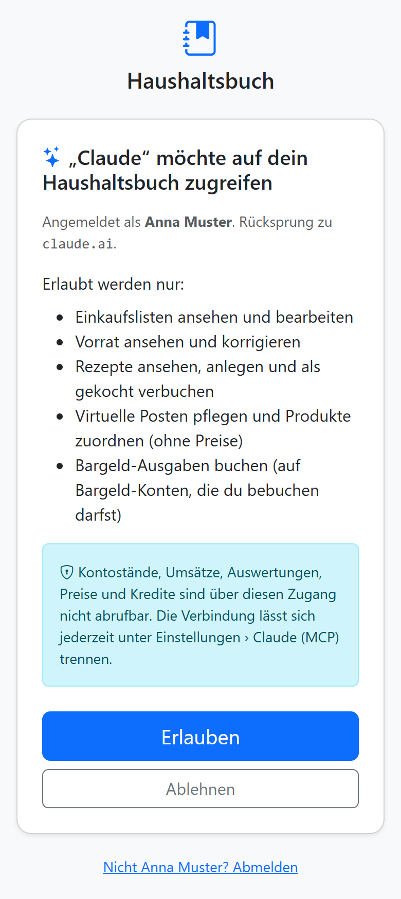

Unter **Einstellungen › Claude (MCP)** siehst du deine verbundenen Apps (Administratoren sehen alle im Haushalt) und
kannst eine Verbindung mit **Trennen** sofort sperren. Das **Protokoll** zeigt alles, was über Claude geändert wurde.
Schaltet ein Administrator den Zugang aus, sind alle Verbindungen sofort gesperrt.

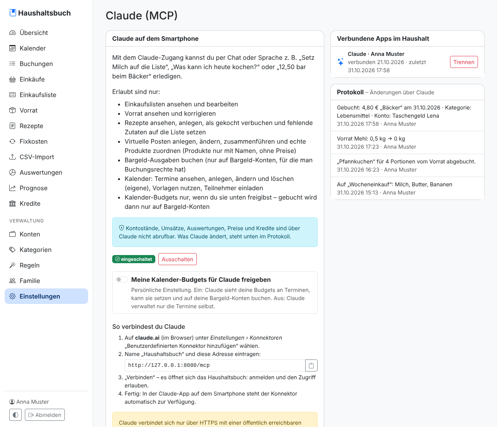

> **Hinweis:** Das klappt nur, wenn das Haushaltsbuch über **HTTPS** im Internet erreichbar ist – nicht bei einer
> rein lokalen Installation.

---

## 15. Für Administratoren: Konten, Familie, Einstellungen

### Ersteinrichtung

Beim allerersten Aufruf führt das Haushaltsbuch durch die Einrichtung: Haushaltsname, dein Administrator-Zugang und
das erste Konto. Danach geht es mit den folgenden Schritten weiter.

### Konten

Unter **Konten** legst du Girokonten, Sparkonten, Bargeld, Kreditkarten usw. an.

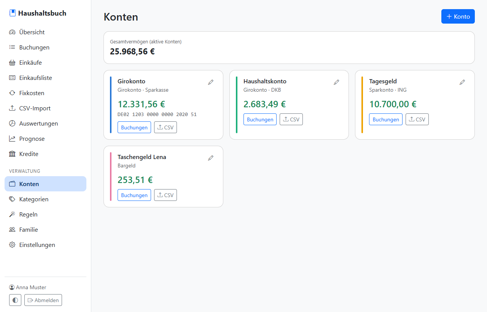

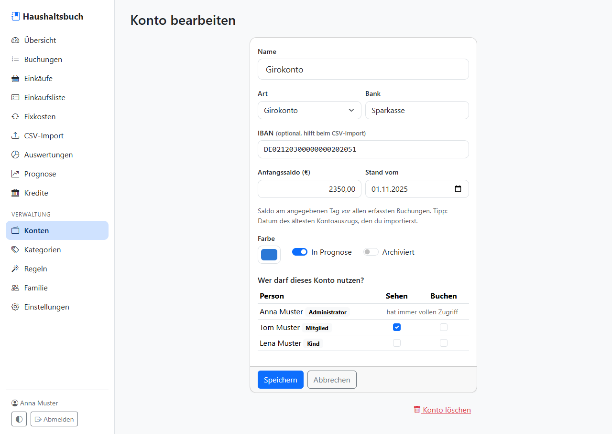

- **Anfangssaldo** und **Stand vom**: der Kontostand am angegebenen Tag *vor* allen erfassten Buchungen. Am besten das
  Datum des ältesten Kontoauszugs nehmen, den du importierst.
- **IBAN** hilft beim CSV-Import. **Farbe**: So erscheint das Konto in Listen und Diagrammen.
- **In Prognose** aus: Das Konto wird in der Prognose nicht berücksichtigt (z. B. Taschengeld der Kinder).
- **Archiviert**: Das Konto wird ausgeblendet, die Buchungen bleiben erhalten. Konten mit Buchungen werden nicht
  gelöscht, sondern nur archiviert.
- **Wer darf dieses Konto nutzen?**: je Person **Sehen** und **Buchen** freigeben. Administratoren haben immer vollen Zugriff.

### Familie

Unter **Familie** legst du weitere Personen an (Name, E-Mail als Anmeldename, Passwort, Rolle) und gibst ihnen Konten frei.
**Aktiv** aus sperrt den Zugang, ohne etwas zu löschen. Das Passwort einer Person setzt du hier neu, wenn sie es vergessen hat.

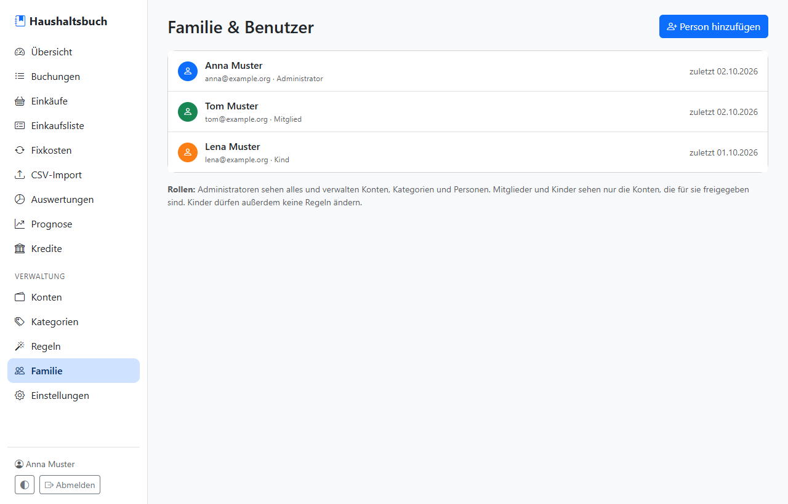

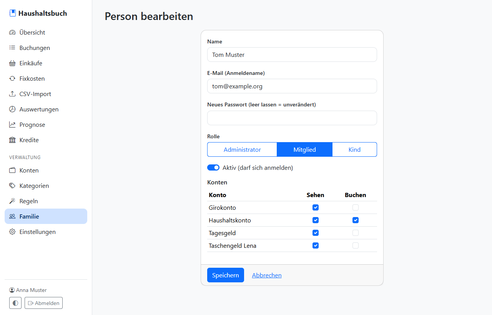

### Einstellungen

- **Name** des Haushalts.
- **Kassenbon- und PDF-Erkennung**: *Lokal im Browser* (kostenlos, ungenauer) oder *KI (Claude)*. Die KI braucht einen
  API-Schlüssel von console.anthropic.com und kostet wenige Cent pro Bon. Beim Einlesen kann trotzdem jederzeit
  gewechselt werden.
- **Prognose**: Standard-Zeitraum und aus wie vielen Monaten der Durchschnitt gebildet wird.
- **Claude (MCP)**: Zugang für die Claude-App ein- und ausschalten, siehe [Kapitel 14](#14-claude-auf-dem-smartphone).

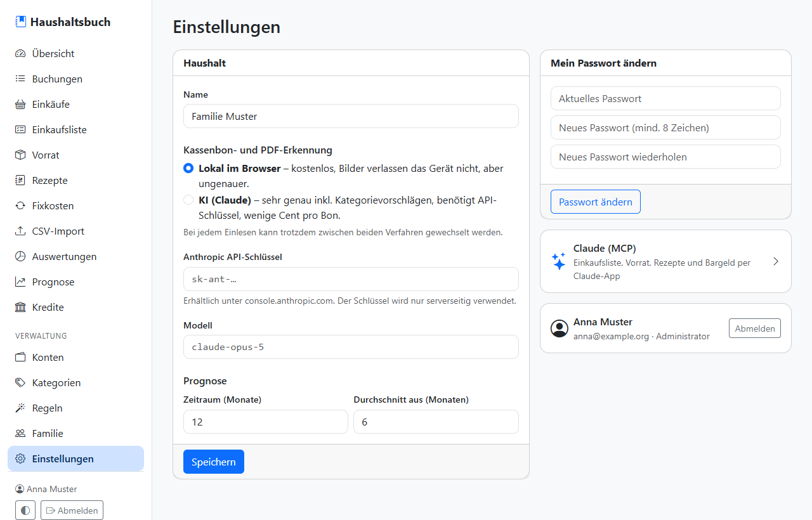

---

## 16. Häufige Fragen

**Muss ich Fixkosten jeden Monat selbst buchen?**
Nein. Fällige Fixkosten mit „Automatisch buchen“ werden beim ersten Öffnen des Haushaltsbuchs am Tag selbst gebucht.

**Ich habe einen Kontoauszug doppelt importiert, gibt es jetzt alles zweimal?**
Nein. Bereits importierte Zeilen werden erkannt und übersprungen.

**Ich importiere die Auszüge von Girokonto und Tagesgeld. Zählt eine Umbuchung dazwischen doppelt?**
Nein. Beim ersten Import wird sie als Umbuchung angelegt (beide Seiten), beim Import des anderen Kontos wird dessen
Zeile mit der schon vorhandenen Seite zusammengeführt. Am zuverlässigsten klappt das, wenn bei beiden Konten die IBAN
eingetragen ist.

**Eine Buchung aus dem Import und ein fotografierter Kassenbon betreffen denselben Einkauf. Zählt er doppelt?**
Nicht, wenn beide verknüpft sind. Beim Speichern des Einkaufs „Vorhandene Buchung wählen“ nehmen oder beim
Import „Zusammenführen“.

**Die Kategorie-Vorschläge passen nicht.**
Einfach die richtige Kategorie wählen. Das Haushaltsbuch lernt daraus. Für feste Zuordnungen eine Regel anlegen.

**Die Prognose wirkt zu hoch oder zu niedrig.**
Unter **Annahmen je Konto** prüfen, welcher Durchschnitt verwendet wird. Einmalige Ausgaben über ihre Kategorie
ausklammern, fehlende Fixkosten anlegen oder ein Szenario mit eigenen Werten nutzen.

**Der Vorrat stimmt nicht mit dem Kühlschrank überein.**
Das ist normal, denn Verbrauch außerhalb von Rezepten sieht das Haushaltsbuch nur über die Verbrauchsdauer. Unter
**Vorrat** den Bestand mit **Setzen** korrigieren und bei häufigen Abweichungen die Verbrauchsdauer des Postens oder
Artikels anpassen.

**Kann ich auch den dunklen Modus nutzen?**
Ja, über das Symbol ◐ (am Computer unten links, am Handy oben rechts).

**Ich sehe ein Konto nicht.**
Es ist für dich nicht freigegeben. Ein Administrator kann das unter **Konten** oder **Familie** ändern.
